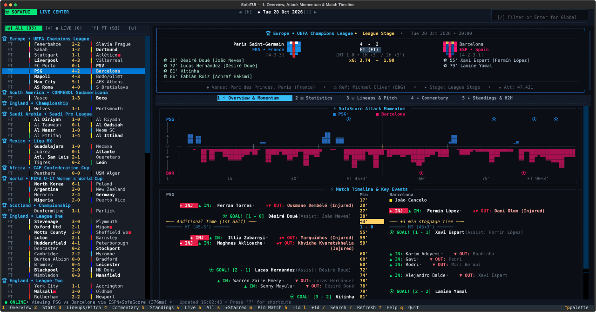
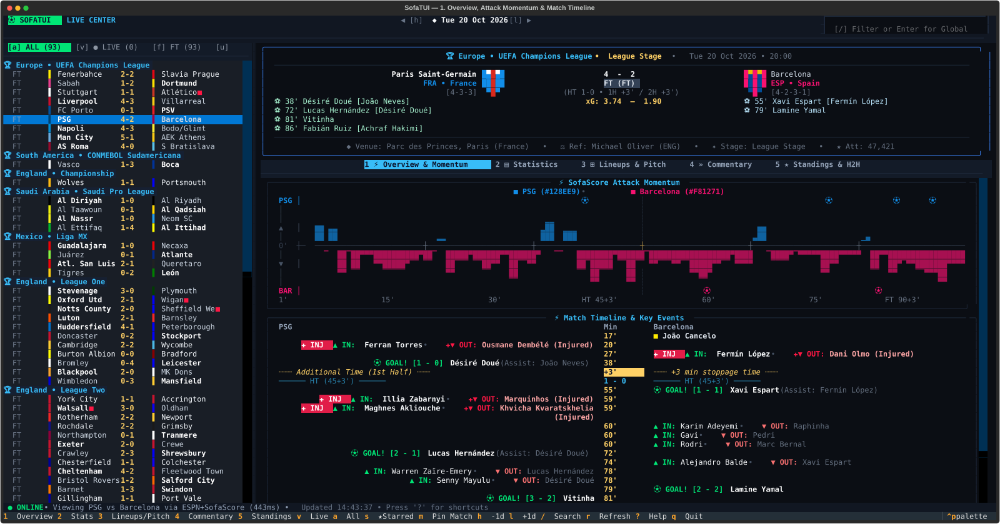
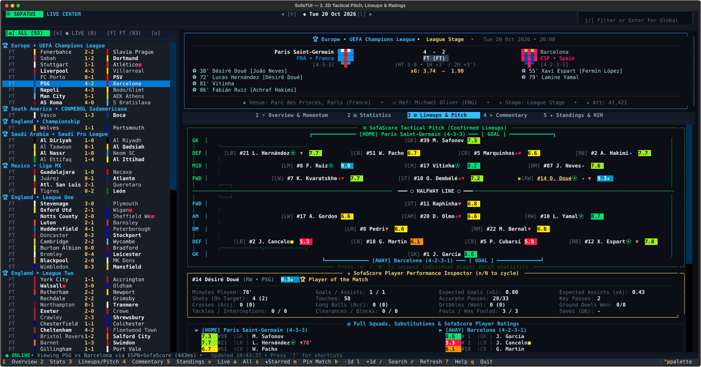
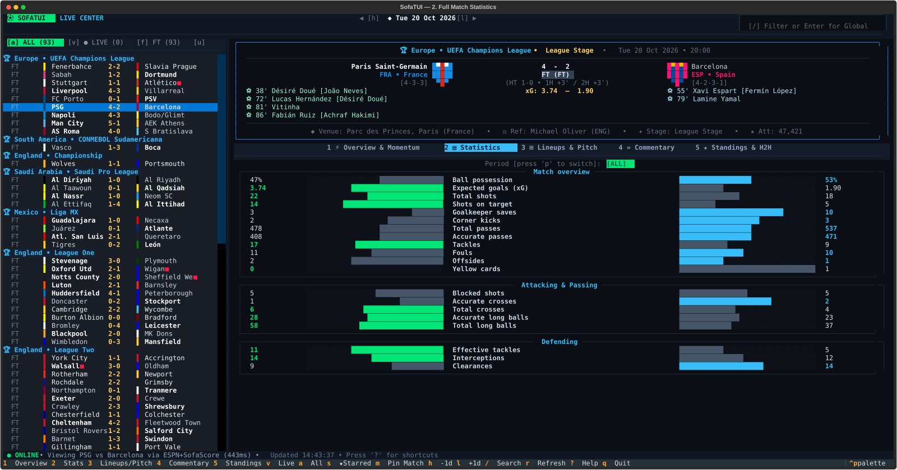
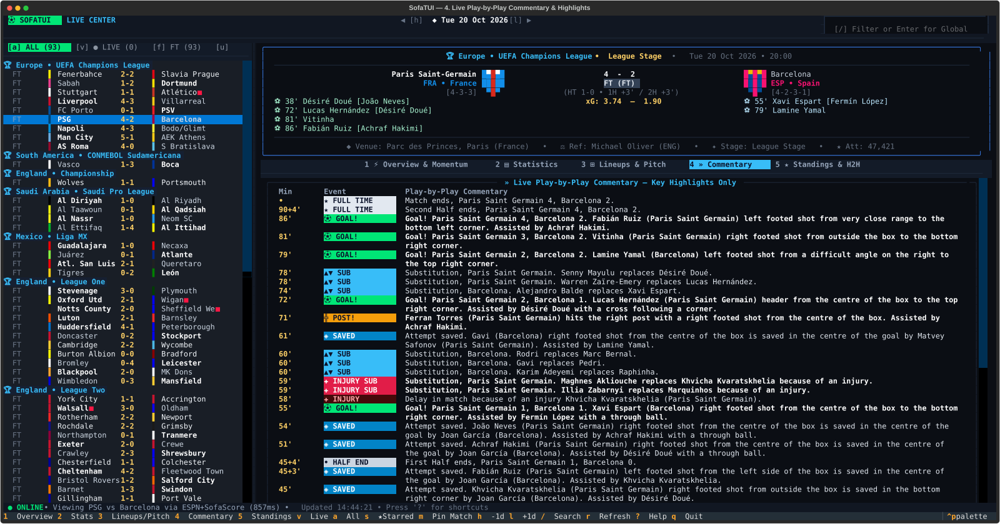
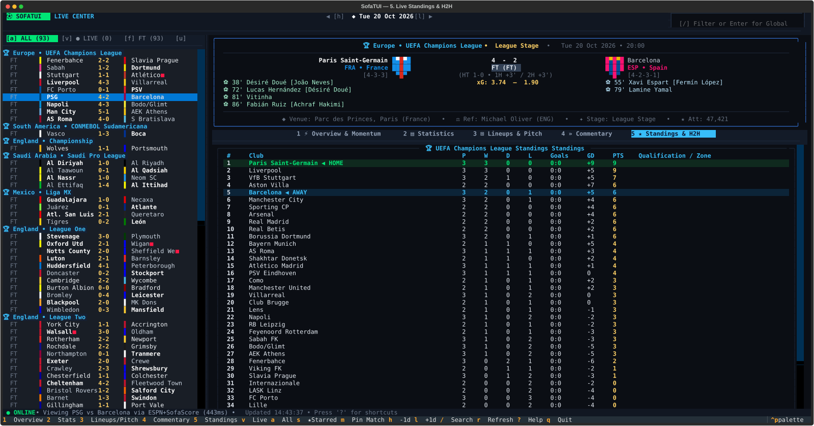

# ⚽ SofaTUI — SofaScore in Your Terminal

A full-featured, fast, SofaScore-style Terminal User Interface (TUI) for live football scores, match statistics, Attack Momentum graphs, 2D tactical pitch formations, SofaScore player ratings, play-by-play commentary, and live league standings.



## 📸 Screenshots

| 1. Overview, Attack Momentum & Timeline | 3. 2D Tactical Pitch, Lineups & Ratings |
| :---: | :---: |
|  |  |

| 2. Full Match Statistics | 4. Play-by-Play Commentary & Highlights | 5. Live Standings & H2H |
| :---: | :---: | :---: |
|  |  |  |

## ✨ Features

- **Real-Time SofaScore Data Engine**:
  - Live matches worldwide (`/sport/football/events/live`) & daily scheduled fixtures across top leagues (UEFA Champions League, Europa League, Premier League, LaLiga, Serie A, Bundesliga, Ligue 1, Liga Portugal, Brasileirão, etc.).
  - Direct sub-15ms UDP IPv4 DNS resolution (`1.1.1.1`/`8.8.8.8`) + Chrome TLS impersonation so requests complete in ~100–300ms even when local `/etc/resolv.conf` VPN resolvers are offline.
- **5-Tab SofaScore Match Center**:
  1. **`[1]` ⚡ Overview & Attack Momentum**:
     - **SofaScore Attack Momentum Graph**: Minute-by-minute (`1'`–`90+'`) bi-directional pressure chart with goal (`⚽`) and red card (`🟥`) markers.
     - **Chronological Match Timeline**: 1st Half / 2nd Half / Extra Time incidents (Goals, Assists, Shot xG, Yellow/Red Cards, Substitutions, VAR decisions, Added Time).
     - **Team Form & H2H**: Recent 5-match `W`/`D`/`L` badges and historical Head-to-Head record.
  2. **`[2]` 📊 Full Match Statistics**:
     - Switch between **`ALL`**, **`1ST`**, and **`2ND`** half (`p` key).
     - Proportional dual-bar visual comparisons for *Match Overview*, *Shots*, *Attack*, *Passes*, *Duels*, *Defending*, and *Goalkeeping* (Ball Possession, Expected Goals `xG`, Big Chances, Shots on Target, Touches in Box, Accurate Passes, Tackles, Saves, etc.).
  3. **`[3]` 🏟 2D Tactical Pitch, Lineups & Player Ratings**:
     - **2D Tactical Pitch**: Starting XIs arranged in their actual formations (`4-3-3`, `4-2-3-1`, etc.) with shirt numbers, incident icons (`⚽👟🟨🟥`), and **color-coded SofaScore Rating Badges** (`9.0+` blue, `8.0+` emerald, `7.0+` green, `6.5+` yellow, `<6.0` red) + `★` Player of the Match (`MOTM`).
     - **Interactive Player Stats Inspector**: Cycle through players with `n` / `N` to inspect individual match stats (Minutes, Goals, Assists, xG, xA, Shots, Touches, Accurate Passes, Key Passes, Crosses, Duels Won, Dribbles, Tackles, Interceptions, Clearances, Saves).
     - **Full Bench & Injured/Missing Players** lists.
  4. **`[4]` 🎙 Live Play-by-Play Commentary**:
     - Minute-by-minute text commentary with color-coded event badges (`⚽ GOAL`, `🟨 YELLOW`, `🟥 RED`, `🧤 SAVED`, `🔄 SUB`, `📺 VAR`). Press `k` to filter between *Key Highlights* and *All Play-by-Play*.
  5. **`[5]` 🏆 Live Standings & Head-to-Head**:
     - Full tournament league table with Champions League / Europa / Relegation zones, automatically highlighting the **Home** (`◀ HOME`) and **Away** (`◀ AWAY`) clubs.

## 📦 Installation (Arch Linux Native Package)

Build and install natively via `pacman` / `makepkg`:

```bash
git clone https://github.com/wthernani/sofatui.git
cd sofatui
makepkg -si
```

Once installed, run `sofatui` (or `scores-tui`) from anywhere in your terminal:

```bash
sofatui
```

## 🚀 Usage

Run the interactive TUI directly from a checkout:

```bash
./sofatui
```

Or via a local virtualenv:

```bash
./.venv/bin/sofatui
```

### CLI Options

```bash
# Launch interactive TUI for today
./sofatui

# Launch interactive TUI for a specific date
./sofatui --date 2026-10-18

# Open directly to a specific SofaScore match ID
./sofatui --match-id 16363889

# Render a non-interactive Rich snapshot of matches + all 5 Match Center tabs
./sofatui --dump --date 2026-10-18
./sofatui --dump --search "Arsenal"
```

## ⌨️ Keyboard Shortcuts

| Key | Action |
| --- | --- |
| `↑` / `↓` | Navigate match list or scroll Match Center |
| `Enter` | Load selected match into Match Center |
| `1` – `5` | Switch tabs: `1` Overview/Momentum, `2` Stats, `3` Lineups/Pitch, `4` Commentary, `5` Standings |
| `h` / `l` or `[` / `]` | Previous day (`-1d`) / Next day (`+1d`) |
| `t` | Jump to Today's matches |
| `a` / `v` / `f` / `u` / `s` | Filter: `All` / `● Live` / `Finished` / `Upcoming` / `★ Starred` |
| `m` | Pin / Star (`★`) current match to persistent favorites |
| `p` | Cycle Statistics period (`ALL` / `1ST` / `2ND` half) |
| `n` / `N` | Cycle Next / Previous Player in Lineups Inspector |
| `k` | Toggle Key Commentary Highlights vs All Commentary |
| `/` | Filter current list or press `Enter` for **Global SofaScore Search** (teams, leagues, matches) |
| `r` | Refresh live scores & current match details |
| `?` | Open keyboard shortcuts help modal |
| `q` | Quit SofaTUI |
